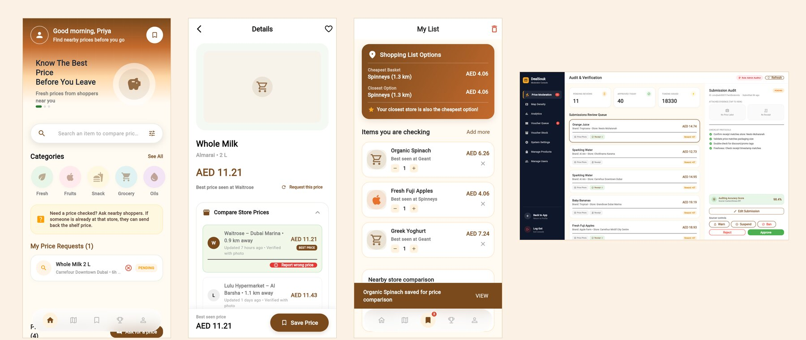
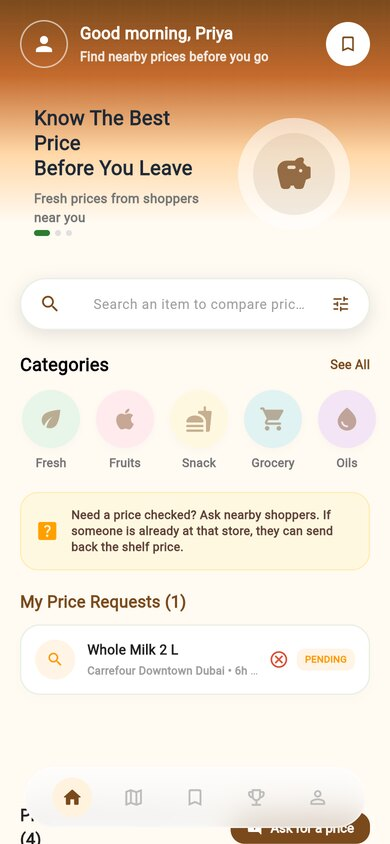
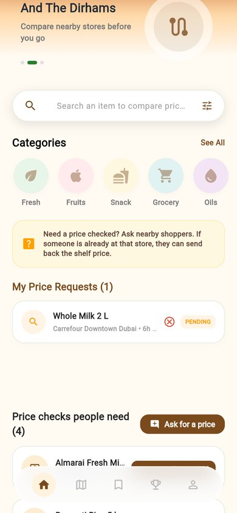
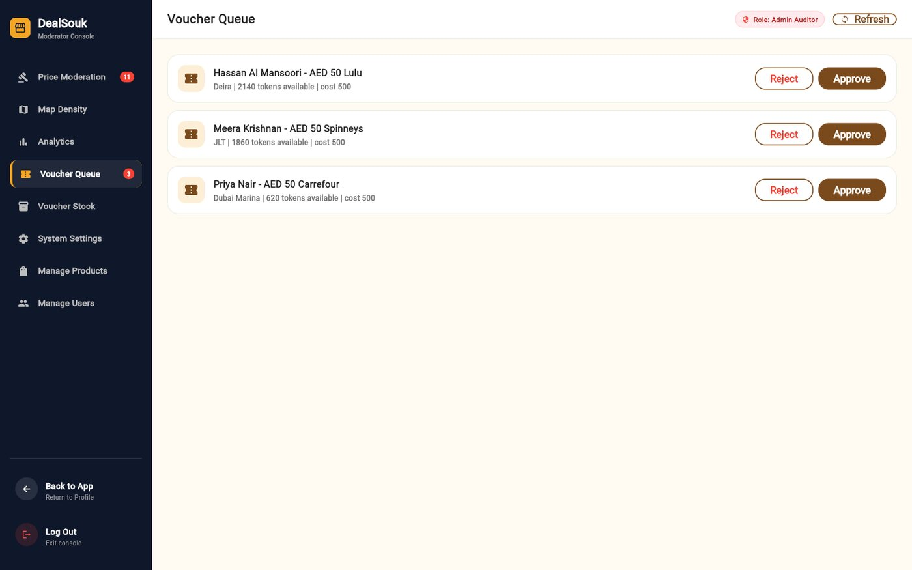
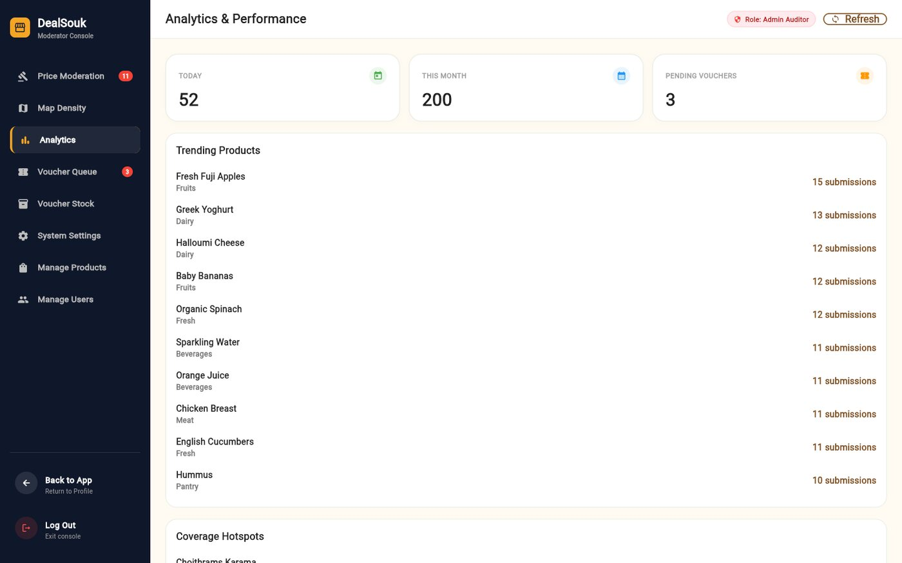
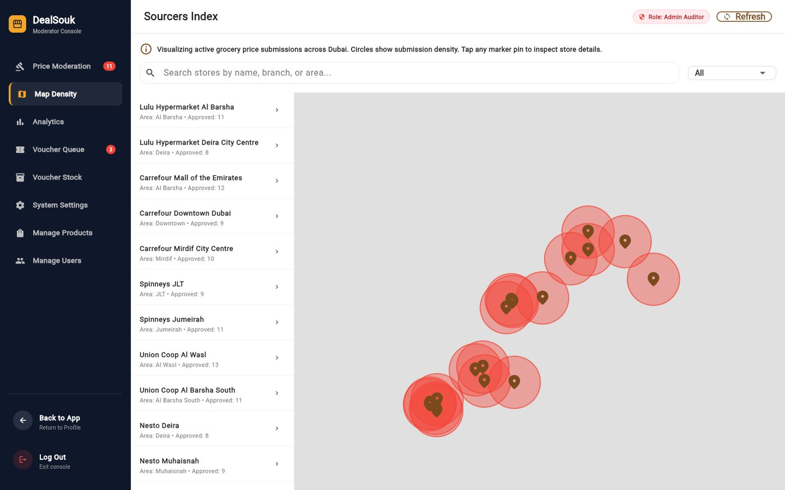

# DealSouk

[](https://github.com/Hikki-dev/DealSouk/actions/workflows/ci.yml)
[](https://github.com/Hikki-dev/DealSouk/actions/workflows/demo.yml)
[](https://deal-souk.vercel.app)


**Prices shared by shoppers, checked by moderators.** DealSouk is a supermarket price comparison app for Dubai. Shoppers find the cheapest groceries near them, share the prices they see on the shelf, ask for a price check and earn rewards. A moderator portal keeps the data honest.

<p align="center"></p>

<p align="center"><sub>Real screens of the running app with demo data. <b><a href="https://deal-souk.vercel.app">Open the live admin portal</a></b>, or <a href="docs/Demo%20mode.md">run the whole thing yourself</a> with no Firebase project.</sub></p>

There are three parts, one repository:

1. **DealSouk Shopper**: the companion app for comparing prices, building a shopping list, sharing and requesting prices, and climbing the leaderboard.
2. **DealSouk Admin**: a moderator portal (the same Flutter code, built with `ADMIN_MODE=true`) to review submissions, handle vouchers, manage the catalogue and users, and read the numbers.
3. **DealSouk API**: a Node.js and TypeScript REST API with Express, Prisma and Postgres, and Firebase for sign-in.

## On this page

* [What you get](#what-you-get)
* [How everything fits together](#how-everything-fits-together)
* [Try it first](#try-it-first): the live portal, or the whole stack on your computer
* [A tour of the screens](#a-tour-of-the-screens)
  * [Shoppers](#shoppers)
  * [Moderators](#moderators)
* [API overview](#api-overview)
* [Run it with your own Firebase](#run-it-with-your-own-firebase)
* [Configuration](#configuration)
* [Testing and CI](#testing-and-ci)
* [Your privacy and safety](#your-privacy-and-safety)
* [Known issues](#known-issues)
* [Help and more reading](#help-and-more-reading)

## What you get

### Shoppers

* **Search and compare** prices across Dubai supermarkets. Each product shows its cheapest fresh price, and a price stays fresh for **72 hours**.
* **A shopping list** that finds the cheapest complete basket, and the closest store, across stores.
* **A barcode scanner** to look a product up at once.
* **Nearby stores** on a map, with each store's price list and a price history chart.
* **Share a price** with a shelf or receipt photo and earn tokens.
* **A requests board**: ask for a price check, or answer someone else's for a bounty.
* **Rewards**: tokens, daily challenges, streaks, badges, a monthly **leaderboard** and supermarket **vouchers**.
* **Saved items**, push notifications, **English and Arabic** (with right-to-left layout), and an offline queue that syncs when the connection returns.

### Moderators

* **A review queue**: approve, reject or edit submissions, and look at flagged ones. A price is hidden after 3 different flags.
* **User actions**: warn, suspend or ban, all written to an audit log.
* **Catalogue and user management**, a voucher queue and **voucher stock import**.
* **Analytics**, a map of where prices come from, and **CSV and PDF exports**.
* Settings such as the voucher threshold, and a maintenance switch.

## How everything fits together

<p align="center"><a href="docs/images/how-it-fits.svg"></a></p>

* **One Flutter code base, two apps.** `ADMIN_MODE` picks the shopper or the moderator app at build time.
* **Sign in** is Firebase Authentication (Google, Apple, phone code). The API checks the Firebase ID token and keeps a matching user row. The admin role is stored in the database.
* **Uploads:** the app asks the API for a signed address, uploads the photo straight to Firebase Storage, and a Cloud Function and a malware scanner process the file.
* **The token ledger:** every token change is written as a hash-chained row, so the history can be checked.

A shared price goes through a few steps before it counts:

<p align="center"><a href="docs/images/price-lifecycle.svg"></a></p>

The rules and the numbers are in [How it works](docs/How%20it%20works.md).

## Try it first

**The live admin portal:** <https://deal-souk.vercel.app>. It needs a moderator account. The API runs on Render at `https://dealsouk.onrender.com` (`/health` shows its status).

**The whole stack on your computer**, with no Firebase project, no Neon and no accounts. It runs the real shopper app, the real moderator portal and the real API against a local Postgres and the Firebase Auth **emulator**, with 18 Dubai stores, 20 products, 175 prices, a leaderboard and a moderation queue:

```bash
git clone https://github.com/Hikki-dev/DealSouk.git
cd DealSouk
bash demo/prepare.sh                      # fake config files, and a throwaway key
# a Postgres on this computer, for example with Docker:
docker run -d --name dealsouk-db -e POSTGRES_HOST_AUTH_METHOD=trust -e POSTGRES_DB=dealsouk -p 5432:5432 postgres:16
npx firebase-tools emulators:start --only auth --project demo-dealsouk    # leave running
bash demo/seed.sh                         # in a second terminal: tables, stores, prices, demo people
cd backend && npm run dev                 # the API, on http://localhost:3000
```

Then, in a third terminal, the shopper app (or the moderator portal, with `ADMIN_MODE=true`):

```bash
flutter run -d chrome --dart-define=API_BASE_URL=http://localhost:3000 \
  --dart-define=USE_FIREBASE_EMULATORS=true
```

Everything is explained in [Demo mode](docs/Demo%20mode.md), including how to sign in as the demo shopper or the demo moderator.

## A tour of the screens

The pictures are taken from the demo above. Click one to see it full size.

### Shoppers

<p align="center">




</p>

You can browse as a guest, or sign in with Google, a phone code or Apple. The home screen has a search box, the categories, your price requests and the daily challenge. A product shows the best price, where it is, how far, and how old the price is, with a **Report wrong price** link on every line.

<p align="center">


</p>

The **shopping list** works out the cheapest basket across stores, the closest option, and how much you would save. The **map** shows 18 Dubai stores with their chains, and each store lists the prices people have shared.

<p align="center">


</p>

Sharing prices earns **tokens**. The rewards page shows your balance, your rank, your streak, a progress bar to the next voucher and your badges. The **leaderboard** resets every month. The **request board** lists price checks other shoppers need, each with a bounty.

<p align="center">



</p>

Every token has a reason you can read, and every price you shared shows whether it is approved or still waiting.

### Moderators

<a href="docs/images/admin-moderation.jpg"></a>

The moderator console opens on the **review queue**. Each submission shows the price, the product, the store and any photos, with a checklist, the shopper's accuracy score, and buttons to approve, reject, edit, warn, suspend or ban.

<a href="docs/images/admin-vouchers.jpg"></a>

<a href="docs/images/admin-analytics.jpg"></a>

<a href="docs/images/admin-map.jpg"></a>

More: [voucher stock](docs/images/admin-stock.jpg), [system settings](docs/images/admin-settings.jpg), [product catalogue](docs/images/admin-products.jpg) and [user directory](docs/images/admin-users.jpg). A walk through every screen is in [Using the app](docs/Using%20the%20app.md).

## API overview

All routes are served by the Express app in `backend/src/index.ts`. Write endpoints are rate limited. Routes marked "auth" need a Firebase ID token, and `/admin/*` also needs the admin role.

| Module | Base path | Highlights |
|---|---|---|
| Auth | `/auth` | `POST /verify` exchanges a Firebase token for a DealSouk user |
| Products | `/products` | `GET /search`, `/:id`, `/:id/prices`, `/:id/history` |
| Stores | `/stores` | `GET /nearby`, `/:id`, `/:id/prices` |
| Submissions | `/submissions` | `GET /feed`, `GET /estimate`, `POST /` (auth), `POST /:id/flag` (auth) |
| Requests | `/requests` | `GET /board`, `GET /mine`, `POST /`, `POST /:id/fulfill`, `DELETE /:id` |
| Profile | `/profile` | `/me`, `/me/transactions`, `/me/vouchers`, `/me/submissions`, `/me/cart`, `/me/requests`, `/me/fcm-token`, `DELETE /me` |
| Leaderboard | `/leaderboard` | `GET /monthly` |
| Challenges | `/challenges` | `GET /today` |
| Uploads | `/uploads` | `POST /signed-url` |
| Translate, Logos, Config | `/translate`, `/logos/:slug`, `/config` | Helpers and client configuration |
| Admin | `/admin` | `/queue`, `/submissions/:id/{approve,reject}`, `/users/:id/{warn,suspend,ban}`, `/products`, `/users`, `/vouchers`, `/analytics`, `/settings`, `/exports/*` |

The server also exposes `/health`.

### Project structure

```
lib/                     Flutter client
├── app/                 App, router, route guard
├── core/                Network, offline queue, theme, l10n helpers, shared widgets
├── features/            One folder per feature: admin, auth, cart, home, leaderboard,
│                        legal, products, profile, requests, saved, stores,
│                        submissions, tokens  (data / domain / presentation)
└── l10n/                English and Arabic strings
backend/                 Express + TypeScript + Prisma API
├── src/routes/          One router per module (admin is split into 3 routers)
├── src/services/        Token engine, notifications, encryption, PDF, Redis, storage
├── prisma/              Schema, migrations, seed, and demo data
├── scripts/             Admin promotion, claim audit, demo token
└── test/                Jest tests
firebase/                Storage rules and Cloud Functions
services/malware-scanner Cloud Run ClamAV service
demo/                    Run everything locally with no Firebase project
scripts/                 secret_scan.py, history purge helper
.github/workflows/       CI, demo check, Android and iOS builds, admin web build, keep-warm
```

## Run it with your own Firebase

### 1. The API

You need Node 20, a Postgres database (Neon works well) and a Firebase project.

```bash
cd backend
npm install
cp .env.example .env          # fill in DATABASE_URL, the FIREBASE_* values and the rest
npx prisma generate
npx prisma migrate deploy     # or `migrate dev` while developing
npm run seed                  # stores, products, badges and sample prices (optional)
npm run dev
```

To make a registered user a moderator:

```bash
npm run admin:set -- --email admin@example.com --admin
```

### 2. The Flutter apps

```bash
flutter pub get
flutterfire configure         # writes lib/firebase_options.dart (git-ignored)
flutter run --dart-define=API_BASE_URL="http://localhost:3000"                          # shopper
flutter run --dart-define=API_BASE_URL="http://localhost:3000" --dart-define=ADMIN_MODE=true   # moderator
```

`setup.sh` helps with the first run. Release builds need an `https://` API address.

### 3. Build-time settings (`--dart-define`)

| Key | Example | Purpose | In release builds |
|---|---|---|---|
| `API_BASE_URL` | `https://your-domain.com` | The address of the API | **Required.** A blank or non-HTTPS value stops the app with a `StateError` |
| `GOOGLE_WEB_CLIENT_ID` | `548247...apps.googleusercontent.com` | OAuth client id for Google sign-in on the web | Required for web sign-in |
| `ADMIN_MODE` | `true` or `false` | `true` builds the moderator portal, `false` the shopper app | Defaults to `false` |
| `USE_FIREBASE_EMULATORS` | `true` | Demo mode: sign in against the local Auth emulator | Never use in release |
| `SENTRY_DSN` | `https://...` | Crash reports. Left empty, Sentry is off | Optional |

## Configuration

Copy `backend/.env.example` to `backend/.env`. The main keys:

| Key | Purpose |
|---|---|
| `DATABASE_URL` | Postgres connection string (Neon) |
| `FIREBASE_PROJECT_ID`, `FIREBASE_CLIENT_EMAIL`, `FIREBASE_PRIVATE_KEY` | Firebase Admin credentials |
| `DATABASE_ENCRYPTION_KEY` | Encrypts phone numbers at rest |
| `ALLOWED_ORIGINS` | CORS allow-list |
| `REDIS_URL`, `RATE_LIMIT_REDIS` | Optional Redis-backed rate limiting and caches |
| `*_RATE_LIMIT_PER_MINUTE` | Per-route rate limits |
| `ADMIN_MFA_REQUIRED` | Require multi-factor sign-in for admin API calls |
| `ANTHROPIC_API_KEY` | Optional photo check. Without it, proof photos are not checked by AI |
| `GOOGLE_TRANSLATE_API_KEY` | The `/translate` endpoint |
| `SMTP_*`, `FROM_EMAIL` | Optional email |
| `MAINTENANCE_MODE`, `MAINTENANCE_MESSAGE` | Maintenance switch |

## Testing and CI

```bash
# Flutter client
flutter analyze
flutter test                 # 31 tests

# Backend
cd backend && npm install && npm test   # Jest, 41 tests, runs in band

# Secret scan (also runs in CI)
python3 scripts/secret_scan.py
```

`.github/workflows/ci.yml` checks formatting, `flutter analyze`, `flutter test`, the secret scan, the Prisma client, the backend build and the backend tests on every pull request. `demo.yml` builds the demo: it starts a Postgres, applies the migrations, runs the demo seed and builds the apps with the fake config. `android-internal.yml`, `ios-internal.yml` and `admin-web.yml` build releases, and `keep-warm.yml` pings the hosted API. Manual test plans are in [TEST_PLAN.md](docs/TEST_PLAN.md) and [AUTOMATED_TEST_PLAN.md](docs/AUTOMATED_TEST_PLAN.md).

### Releases

Push a version tag (for example `v1.0.0-rc1`) and create a GitHub Release. A runner builds **DealSouk-Shopper.apk** and **DealSouk-Admin.apk** in parallel and attaches them to the release.

## Your privacy and safety

* Helmet, a CORS allow-list, a request size limit and per-route **rate limiting** (Redis-backed in production).
* Phone numbers are **encrypted at rest** (`DATABASE_ENCRYPTION_KEY`).
* Admin actions are written to an **audit log**, and admin MFA can be required (`ADMIN_MFA_REQUIRED`).
* Uploads are limited by user, type and size, have EXIF stripped and are malware scanned.
* Never commit `.env`, service-account files, `google-services.json`, `GoogleService-Info.plist` or `firebase_options.dart`.

See [SECURITY.md](SECURITY.md), [SECURITY_AUDIT.md](SECURITY_AUDIT.md) and the pre-launch [SECURITY_CHECKLIST.md](SECURITY_CHECKLIST.md).

## Known issues

1. **A cart restored from the server shows no prices.** The server's cart answer holds the product but not its price. A cart you have just built on this device shows prices, and after the next sync with the server the lines show `AED 0.00` and "Best seen at -". The demo avoids saving a cart in the database for this reason.
2. **Maps use OpenStreetMap, not Google Maps.** The product requirements ask for the Google Maps SDK. The app uses `flutter_map` with CartoDB Voyager tiles, so no billing or API key blocks development. `google_maps_flutter` stays in `pubspec.yaml` as a placeholder for a later switch.
3. **`backend/package.json` says Node 20.x.** The demo also runs on Node 22, but only 20 is tested in CI.

## Help and more reading

| If you want to | Read |
|---|---|
| Run it all with no accounts | [Demo mode](docs/Demo%20mode.md) |
| Walk through every screen | [Using the app](docs/Using%20the%20app.md) |
| Understand the rules and the numbers | [How it works](docs/How%20it%20works.md) |
| Fix a problem | [Fixing problems](docs/Fixing%20problems.md) |
| Find a quick answer | [Questions and answers](docs/FAQ.md) |
| Run the manual tests | [Test plan](docs/TEST_PLAN.md) and [automated test plan](docs/AUTOMATED_TEST_PLAN.md) |
| Change the code | [Contributing](CONTRIBUTING.md) |
| Report a security problem | [SECURITY.md](SECURITY.md) |
| See what changed | [Changes](CHANGELOG.md) |

## Contributing

Fixes and ideas are welcome. Read [CONTRIBUTING.md](CONTRIBUTING.md) first.

## Credits

Built with [Flutter](https://flutter.dev), [Riverpod](https://riverpod.dev), [Express](https://expressjs.com), [Prisma](https://www.prisma.io) and [Firebase](https://firebase.google.com). Map data is from [OpenStreetMap](https://www.openstreetmap.org) contributors. Supermarket names and logos belong to their owners.

## Licence

No licence file yet, so for now all rights are reserved by the author.

Built by [Yusuf (Hikki-dev)](https://github.com/Hikki-dev).
