# DealSouk

[](https://github.com/Hikki-dev/DealSouk/actions/workflows/ci.yml)


[](https://deal-souk.vercel.app)

Shoppers in Dubai share what things cost on the shelf, so everyone can see the cheapest supermarket before they leave home.

<p align="center">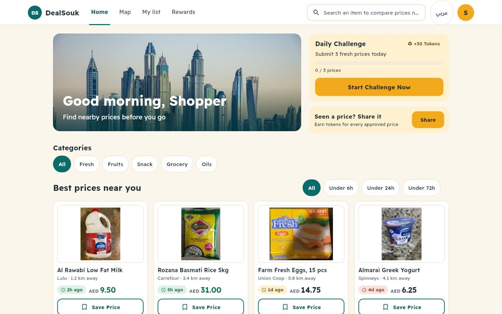</p>

You search for an item and see its price in every nearby store, with how fresh each price is. When you spot a price on a shelf, you take a photo and earn tokens. Tokens turn into supermarket vouchers.

Nobody orders anything here. DealSouk only helps you decide where to go.

It works on phones, tablets and desktops, in English and in Arabic, and the text can be made larger for anyone who needs it.

## On this page

* [What you get](#what-you-get): what shoppers and moderators can do
* [How everything fits together](#how-everything-fits-together): the pieces, and the journey of one price
* [Try it first](#try-it-first): the live links
* [The app, step by step](#the-app-step-by-step)
  * [1. Welcome](#1-welcome)
  * [2. Home](#2-home)
  * [3. Search](#3-search)
  * [4. One product, every store](#4-one-product-every-store)
  * [5. Scan a barcode](#5-scan-a-barcode)
  * [6. The map](#6-the-map)
  * [7. My list](#7-my-list)
  * [8. Share a price](#8-share-a-price)
  * [9. Rewards](#9-rewards)
  * [10. Profile and settings](#10-profile-and-settings)
* [Made for everyone](#made-for-everyone): Arabic, large text, phones and desktops
* [The moderator console](#the-moderator-console)
* [Run it yourself](#run-it-yourself)
* [Putting it online](#putting-it-online)
* [Your privacy and safety](#your-privacy-and-safety)
* [Help and more reading](#help-and-more-reading)
* [Photo credits](#photo-credits)

## What you get

There are three parts. Each does one job.

| Part | Who it is for | What it does |
|---|---|---|
| **Shopper app** | Everyone | Compare prices, find stores, share prices, earn rewards |
| **Moderator console** | The team | Check shared prices, stop fraud, hand out vouchers |
| **API** | The apps | One safe place for the data, the sign-in checks and the token counts |

**For shoppers**

* Search for an item and see its price in every nearby store. Prices older than 72 hours are marked as old.
* **My list**: put your shopping in one list and see which store is cheapest for the whole basket.
* Scan a barcode to find a product straight away.
* See stores on a map, with their prices and how the price has moved.
* Share a price with a shelf or receipt photo. Ask for a price too, or answer someone else's request.
* Earn tokens, daily challenges, streaks and badges. Climb the monthly leaderboard. Swap tokens for supermarket vouchers.
* Works in English and Arabic (right to left), with a text size setting, and keeps working offline.

**For moderators**

* Approve, change or reject each shared price, with the photos next to a checklist.
* Review flagged prices. A price hides itself after three different people flag it.
* Warn, suspend or ban a user. Every action is written to an audit log.
* Manage products and users, approve vouchers, import voucher stock.
* See analytics and a map of where prices come from. Export CSV and PDF.

## How everything fits together

The shopper app and the moderator console both talk to one API. The API keeps the data in Postgres, and uses Firebase to know who you are, to store photos and to send alerts. Every photo is cleaned and scanned before anyone sees it.

<p align="center"><a href="docs/images/how-it-fits.svg">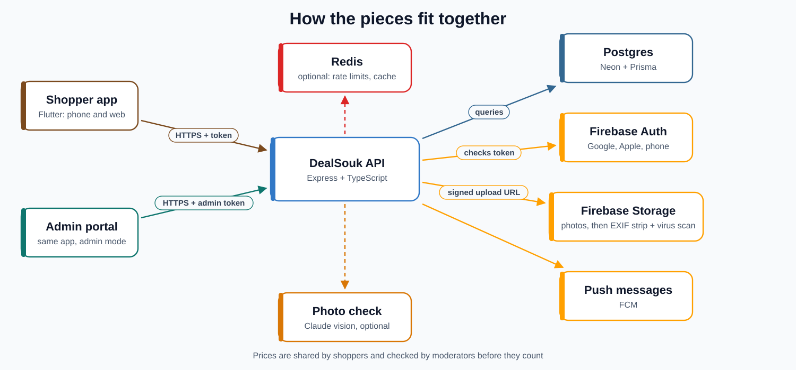</a></p>

Here is the journey of one price, from the shelf to everyone's phone:

<p align="center"><a href="docs/images/price-journey.svg">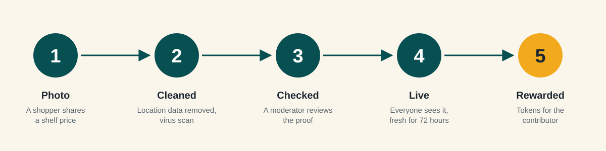</a></p>

The longer version, with the folders and the code behind each step, is in [How it works](docs/How%20it%20works.md) and [How a price travels](docs/How%20a%20price%20travels.md).

## Try it first

* **[Moderator console](https://deal-souk.vercel.app)**: sign in with a moderator account. How to get one is in [Moderator access](docs/Moderator%20access.md).
* **Shopper app on the web**: a second link that shows the shopper app. How it is set up is in [Deploying](docs/Deploying.md).
* **Android**: every release has two downloads, `DealSouk-Shopper.apk` and `DealSouk-Admin.apk`. See [Putting it online](#putting-it-online).

## The app, step by step

Every screen below is a real picture of the app. Phones are on the left and desktops on the right where both exist. Click a picture to see it full size. Every design, side by side with the file that builds it, is in [Screens](docs/Screens.md).

### 1. Welcome

<a href="docs/images/app/welcome-desktop.jpg">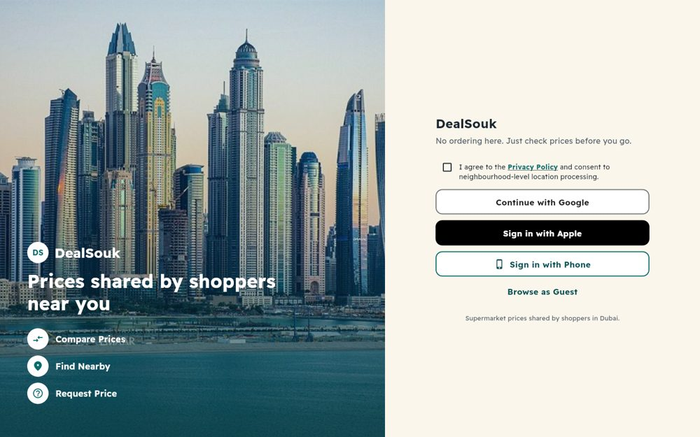</a>

Sign in with Google, Apple or a phone number, or look around as a guest. You agree to the privacy policy once, before you start.

On a phone the photo sits on top and the buttons are underneath.

<a href="docs/images/app/welcome-phone.jpg">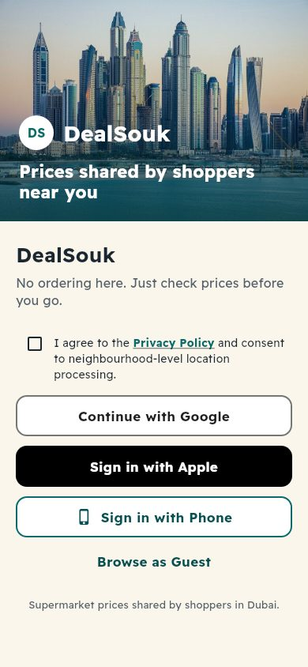</a> <a href="docs/images/app/tutorial-phone.jpg"></a>

The first time you open the app, a five-slide tutorial shows what it does. You can skip it, and you can watch it again from your profile.

### 2. Home

<a href="docs/images/app/home-phone.jpg">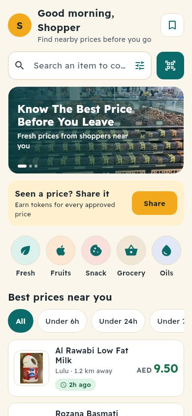</a>

Home shows the best prices near you, a daily challenge, and a button to share a price. The search box and the barcode button are always on top.

### 3. Search

<a href="docs/images/app/search-desktop.jpg"></a>

Type a product and pick a category or how fresh the price must be. Sort by lowest price, nearest or freshest. On a desktop the filters sit on the side.

### 4. One product, every store

<a href="docs/images/app/product-desktop.jpg">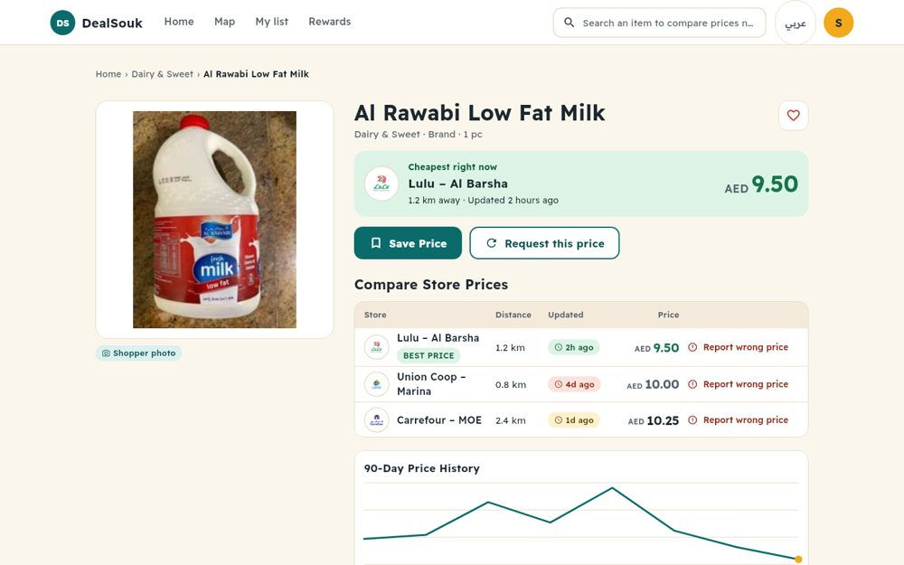</a>

The product page lists every store with its price, how far away it is and how old the price is. The cheapest price is green. A chart shows how the price moved. You can add the item to My list from here.

### 5. Scan a barcode

<a href="docs/images/app/scan-phone.jpg">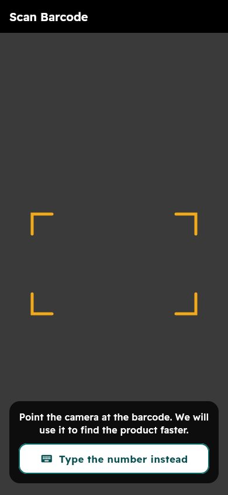</a>

Point the camera at a barcode. If the camera does not work, you can type the number instead.

### 6. The map

<a href="docs/images/app/map-desktop.jpg">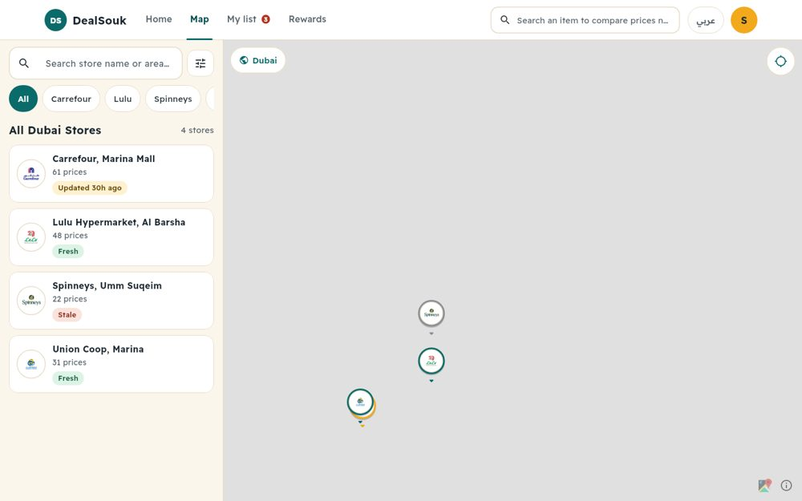</a>

Stores near you appear as pins with their logos. Tap one to see its prices. On a phone the store list slides up from the bottom of the map.

### 7. My list

<a href="docs/images/app/list-desktop.jpg">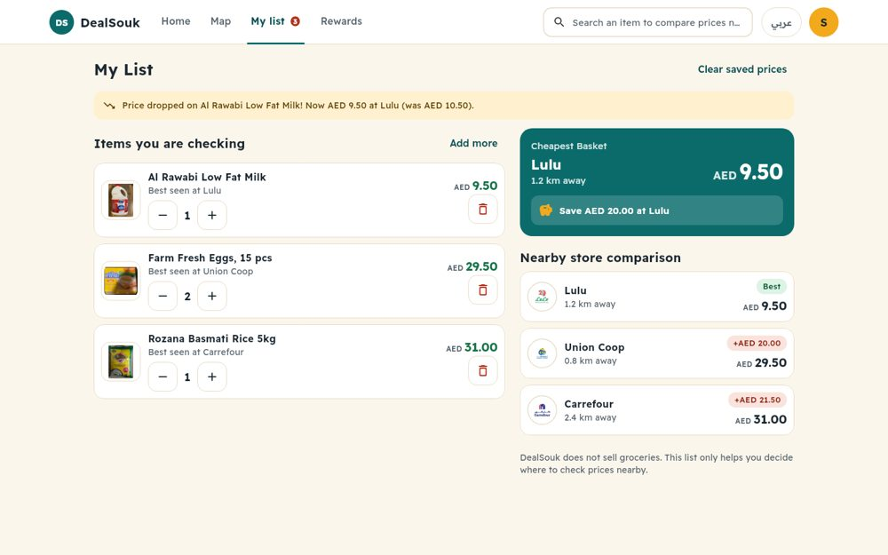</a>

Add the things you plan to buy. DealSouk shows the cheapest store for the whole basket and how much more every other store costs. It also tells you when a price on your list drops.

### 8. Share a price

<a href="docs/images/app/submit-phone.jpg">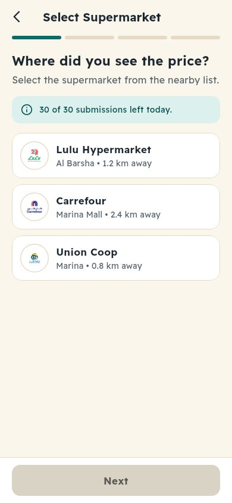</a>

Sharing takes four short steps: choose the store, choose the product, enter the price, then add a photo as proof. Nothing is lost if you are offline. It is sent when the connection comes back.

You can also **ask** for a price. Other shoppers see the request and can answer it, and both of you earn tokens.

### 9. Rewards

<a href="docs/images/app/rewards-desktop.jpg">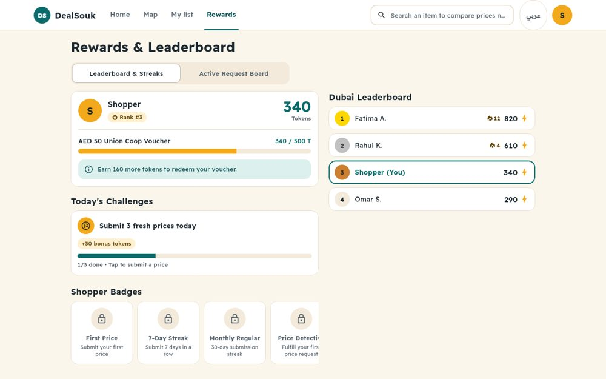</a>

Approved prices earn tokens. A bar shows how close you are to the next voucher. Daily challenges, streaks and badges give extra tokens, and the monthly leaderboard shows who shared the most.

### 10. Profile and settings

<a href="docs/images/app/profile-desktop.jpg"></a>

Your profile shows your level, your tokens, your vouchers and your past prices. Settings let you change the language and the **text size**, replay the tutorial and read the privacy policy.

## Made for everyone

DealSouk is built for ages 14 to 65.

* **Big targets.** Every button is at least 48 pixels tall, so it is easy to hit.
* **Words with colours.** A status is never shown with colour alone. It always has a word or a symbol too.
* **Text size.** Profile, Settings lets you pick Standard, Large or Extra large. Screens are tested at 160 percent text.
* **Arabic.** The whole app flips to right to left, and prices show as `٩٫٥٠ د.إ`.
* **Any screen.** A bottom bar on phones, a side rail on tablets and a top bar on desktops.

<a href="docs/images/app/home-arabic-large-text.jpg"></a> <a href="docs/images/app/map-tablet.jpg">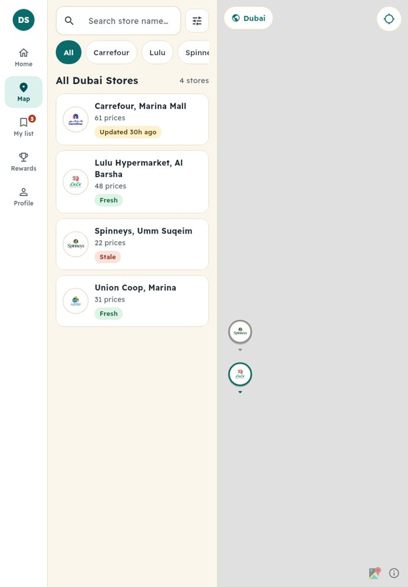</a>

The colours, sizes and parts are written down in [Design system](docs/Design%20system.md).

## The moderator console

<a href="docs/images/app/admin-moderation-desktop.jpg"></a>

On a desktop the console has a sidebar. On a phone the same sections are in a menu.

1. **Price moderation.** Pick a price on the left. On the right you see the photos, a checklist and how reliable this person has been. Approve, edit or reject.
2. **Map density.** See where prices come from.
3. **Analytics.** How many prices, users and tokens over time.
4. **Voucher queue and stock.** Approve voucher requests and import new voucher codes.
5. **System settings, products and users.** Change thresholds, manage the catalogue, warn, suspend or ban.

Export CSV copies the current list so you can paste it into a spreadsheet.

New accounts are shoppers. To make someone a moderator, follow [Moderator access](docs/Moderator%20access.md).

## Run it yourself

You need Node 20 for the API and the Flutter SDK for the apps. The short version:

```bash
# 1. The API
cd backend
npm install
cp .env.example .env        # then fill in the keys
npx prisma generate
npx prisma migrate dev
npm run dev

# 2. The shopper app (in a second window)
flutter pub get
flutterfire configure
flutter run --dart-define=API_BASE_URL="http://localhost:3000"

# 3. The moderator console
flutter run --dart-define=API_BASE_URL="http://localhost:3000" --dart-define=ADMIN_MODE=true
```

Every step, every setting and what to do when it fails is in [Getting started](docs/Getting%20started.md).

## Putting it online

Two websites are built from this one project. They differ by one setting, `APP_MODE`.

| Vercel project | Setting | Shows |
|---|---|---|
| `deal-souk` | `APP_MODE=admin` (default) | The moderator console |
| `deal-souk-shopper` | `APP_MODE=shopper` | The shopper app |

The API runs on Render. Android builds come from GitHub Actions. Publish a release and both `.apk` files are attached to it. The full checklist, including the one Firebase setting that people forget, is in [Deploying](docs/Deploying.md).

## Your privacy and safety

* Phone numbers are encrypted in the database.
* Every photo is stripped of its location data and scanned for viruses before anyone sees it.
* Every moderator action is written to an audit log. Moderators can be required to use a second sign-in step.
* Every token change is written in a chain that can be checked later, so tokens cannot be quietly changed.
* Write requests are rate limited.

Please report a security problem privately. How is in [SECURITY.md](SECURITY.md). The full review is in [SECURITY_AUDIT.md](SECURITY_AUDIT.md) and the pre-launch list is in [SECURITY_CHECKLIST.md](SECURITY_CHECKLIST.md).

## Help and more reading

* [Getting started](docs/Getting%20started.md): run the API and the apps
* [How it works](docs/How%20it%20works.md): the folders and the code
* [How a price travels](docs/How%20a%20price%20travels.md): one price, from shelf to phone
* [API overview](docs/API%20overview.md): every route
* [Design system](docs/Design%20system.md) and [Screens](docs/Screens.md): the look, and every screen
* [The redesign](docs/The%20redesign.md): what changed in the redesign and what is left
* [Deploying](docs/Deploying.md) and [Moderator access](docs/Moderator%20access.md)
* [Fixing problems](docs/Fixing%20problems.md) and [FAQ](docs/FAQ.md)
* [Test plan](docs/Test%20plan.md) and [Automated test plan](docs/Automated%20test%20plan.md)
* [Changes](CHANGELOG.md): what is new, newest first
* [Contributing](CONTRIBUTING.md)

## Photo credits

* **Font:** Readex Pro, SIL Open Font License, bundled in the app. One family covers Latin and Arabic.
* **Dubai Marina:** Norlando Pobre, CC BY 2.0. **Vegetable market:** Ithra Dubai, CC BY-SA 4.0. **Carrefour UAE:** CC BY-SA 4.0, Wikimedia Commons. **Dubai Creek:** public domain. **Burj Khalifa and dunes:** Wikimedia Commons, free licences (the individual authors still need to be added).
* The same credits appear in the app under Privacy and Terms.
* **Maps:** © Mapbox, © OpenStreetMap contributors.
* The market photo shows a real person and has no confirmed model release. Replace it before launch.
