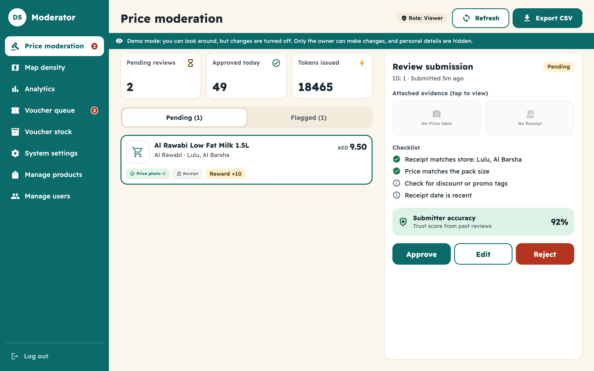

# Demo mode: show both apps, change nothing

DealSouk has two apps, and you want to show both of them off: the **shopper app** for customers and the **moderator console** for the team. Anyone can open the shopper app. The console is different, because it can approve prices, ban people and hand out vouchers. Demo mode lets visitors look around the console without being able to change a thing.

| Who | What they can do in the console |
|---|---|
| **You** (an account made a moderator) | Everything, exactly as before |
| **Anyone else who signs in** | Look at every screen. Nothing can be changed, and personal details are hidden |
| **Not signed in** | Nothing. They see the sign-in page |

## How it works

1. A visitor opens https://deal-souk.vercel.app and signs in with Google, Apple or phone.
2. Because demo mode is on, the API tells the console "this person is a viewer". The console opens, with a banner across the top: *Demo mode: you can look around, but changes are turned off.*
3. Every screen loads real numbers: the queue, the map, analytics, vouchers, stock, settings, products and users.
4. If the visitor presses **Approve**, **Ban**, **Delete** or any other action, the console says the demo is view-only. Behind that, **the API refuses the request too**, so the protection does not depend on the buttons.

<p align="center"></p>

## What viewers do not see

Other shoppers are real people, so a viewer sees a safe copy of the data.

| Hidden from viewers | Shown instead |
|---|---|
| Names of shoppers | The first letter and dots, for example `F•••` |
| Phone numbers, emails, sign-in ids | Empty |
| Voucher codes | Empty |
| Receipt and price-label photos | Empty (see the setting below) |
| The CSV and PDF downloads | Refused. Only moderators can export |

Products, stores, prices, counts, charts and the map are shown in full.

## Turn it on

Demo mode is **off by default**, so a normal deploy stays moderators only.

1. In Render, open the backend service, **Environment**, and add `ADMIN_DEMO_VIEWERS` = `true`.
2. Save. Render redeploys by itself.
3. Open the console in a private window, sign in with an account that is not a moderator, and check the banner is there.

To turn it off, set it to `false` or delete it.

| Setting (backend) | Default | Meaning |
|---|---|---|
| `ADMIN_DEMO_VIEWERS` | `false` | `true` lets any signed-in person view the console, read-only |
| `ADMIN_DEMO_SHOW_PHOTOS` | `false` | `true` also shows other shoppers' receipt and label photos to viewers |

## Making yourself the owner

Only accounts marked as moderators can change anything. You do this on your own computer, never from the website:

```bash
cd backend
npm run admin:set -- --email you@example.com --admin
```

Sign out and in again afterwards. Full steps are in [Moderator access](Moderator%20access.md).

## For your portfolio

* Link to **https://deal-souk.vercel.app** for the console and **https://deal-souk-shopper.vercel.app** for the shopper app.
* Tell visitors to "sign in with Google". They land in the read-only console.
* Take screenshots of the console while signed in as yourself, so they show real photos. Put them in `docs/images/` and link them from the README.

## The rules behind it

* The check lives in one place, `requireAdminOrDemo` in `backend/src/middleware/auth.ts`. Real moderators go through the same checks as before, including the second factor when it is required.
* A viewer can only send `GET` requests. Any other request, and anything under `/admin/exports/`, gets `403` with the code `DEMO_READ_ONLY`.
* Masking is done by `maskForDemo` in `backend/src/services/demoViewer.ts`, on every response a viewer receives.
* Tests for all of this are in `backend/test/api.test.ts` ("demo viewers") and `test/admin/demo_viewer_test.dart`.
