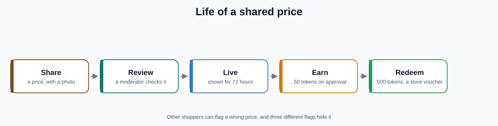

# How it works

The rules and numbers behind the app. All of them live in code, so this page tells you where.

## The numbers

| Rule | Value | Where |
|---|---|---|
| A price stays fresh | 72 hours | `PRICE_FRESHNESS_MS` in `backend/src/config/constants.ts` |
| A store pin shows as stale | after 48 hours with no new price | `STORE_STALE_MS` |
| A price request expires and is refunded | after 48 hours | `REQUEST_EXPIRY_MS` |
| Tokens for an approved price | 50 (`tokenEarnRate`, an admin setting) | `AdminSettings` |
| Tokens needed for a voucher | 500 (`voucherThreshold`) | `AdminSettings` |
| Most prices a shopper can share a day | 30 (`dailySubmissionCap`) | `AdminSettings` |
| Tokens to ask for a price | 10 (`requestCostTokens`) | `AdminSettings` |
| One level for every | 500 lifetime tokens, up to level 20 | `TOKENS_PER_LEVEL`, `MAX_LEVEL` |
| A shared price is hidden after | 3 different flags | submissions route |
| A shopper is suspended for 7 days after | 3 removals in 30 days | `SUSPENSION_DURATION_MS`, `REMOVAL_LOOKBACK_MS` |

The admin settings can be changed in the moderator portal under **System Settings**.

## A price's life

<p align="center"><a href="images/price-lifecycle.svg"></a></p>

1. **Share.** A shopper picks a product and a store, types the price and takes a photo of the shelf tag or the receipt. The app asks the API for a signed address (`POST /uploads/signed-url`) and sends the photo straight to Firebase Storage. A Cloud Function removes the photo's location data (EXIF) and a malware scanner checks it. If an Anthropic key is set, a vision model also checks the proof photo. Without a key that check is skipped.
2. **Review.** The price is saved as `pending`. A moderator sees it in the queue and approves, rejects or edits it.
3. **Live.** An approved price counts for 72 hours. After that it is dimmed and no longer used for the best price.
4. **Earn.** Approval gives the shopper tokens, written to the token ledger. A price for the same product and store that repeats one shared in the last 24 hours is worth less (`decayFactor`, 0.7 by default).
5. **Redeem.** With 500 tokens a shopper asks for a voucher. A moderator approves it and a code from the voucher stock is given to the request.

Other shoppers can **flag** a price as wrong, a mismatch, in the wrong store or a duplicate. Three different shoppers hiding a price is enough.

## The token ledger

Every change to a shopper's tokens is a row in `TokenTransaction`, with the amount, the reason, and a **hash** made from the user, the amount, the reason, the time and the hash of the previous row for the same user. That chain means a row cannot be changed or removed without breaking the next one. `verifyTokenLedgerChain` in `tokenEngine.ts` re-checks the whole chain.

## The leaderboard

`GET /leaderboard/monthly` adds up each shopper's positive token rows since the start of the month and shows the top ten, plus the top three of last month as the Hall of Fame. Your own rank is worked out separately if you are outside the top ten. The board is cached for 60 seconds when Redis is on.

## Price requests

A shopper can ask nearby shoppers for a price they cannot find, and put a bounty of tokens on it. Another shopper who shares that price takes the bounty. If nobody does within 48 hours the request is expired and the tokens are given back.

## Sign in and roles

Firebase Authentication signs a person in. The app sends the Firebase ID token with every call. `requireAuth` (`backend/src/middleware/auth.ts`) checks it, finds the matching user row, and refuses banned and suspended accounts. A session ends after 30 days without use, or 90 days in all. The admin role is a flag on the user row, and `requireAdmin` can also insist on multi-factor sign-in (`ADMIN_MFA_REQUIRED`).

## The data

Prisma models in `backend/prisma/schema.prisma`:

| Model | What it holds |
|---|---|
| `User` | The shopper: name, area, tokens, level, streaks, accuracy, ban and suspension state, `isAdmin` |
| `Store`, `Product` | The 18 stores and the catalogue |
| `PriceSubmission` | A shared price: product, store, price, photos, `status`, flags, tokens given, expiry |
| `SubmissionFlag` | One shopper's flag on one price |
| `TokenTransaction` | The hash-chained token ledger |
| `VoucherRequest`, `VoucherInventory` | A voucher request, and the stock of codes |
| `PriceRequest` | A request for a price, with a bounty |
| `Badge`, `UserBadge` | Badges and who has them |
| `DailyChallenge`, `UserDailyChallenge` | The daily challenge and progress |
| `AdminSettings`, `AdminUserAction` | The one settings row, and the audit log of warnings, suspensions and bans |
| `CartItem` | A shopper's saved list |

## Where things are

```
backend/src/index.ts           the Express app, rate limits and routes
backend/src/routes/            auth, products, stores, submissions, requests, profile, leaderboard, challenges, uploads, admin/
backend/src/services/          tokenEngine, encryption, fcmNotifier, pdfService, redis, storageHelpers, maintenance
lib/features/                  one folder per screen area, split into data, domain and presentation
lib/core/                      network client, offline queue, theme, shared widgets
```
