# Redesign: what changed and how it was verified

The whole app now follows the approved mockups (see [SCREENS.md](SCREENS.md)) on phone, tablet and desktop, in English and Arabic.

## What is new
- **Design system** (`lib/core/design/`, see [DESIGN_SYSTEM.md](DESIGN_SYSTEM.md)): flat cards, 52px buttons, 48px touch targets, bundled Readex Pro and Dubai photos.
- **Responsive shell:** bottom bar (phone), rail (tablet), top bar (desktop). The old phone-shaped frame on the web is gone.
- **Screens rebuilt:** welcome and sign-in (split-screen on desktop), tutorial, home, search, product comparison, barcode scan, map and stores, My list, saved, submit flow, requests, rewards, profile, settings, privacy and credits, unauthorized, and the whole moderator console (sidebar on desktop, drawer on phone).
- **Text size setting** (Profile, Settings): Standard, Large, Extra large, applied app-wide (capped at 160%).
- **Moderator console:** all panels restyled; Pending/Flagged filter; Export CSV copies the queue to the clipboard; English and Arabic strings.

## App screenshots (rendered by the test suite)
| | |
|---|---|
|  | 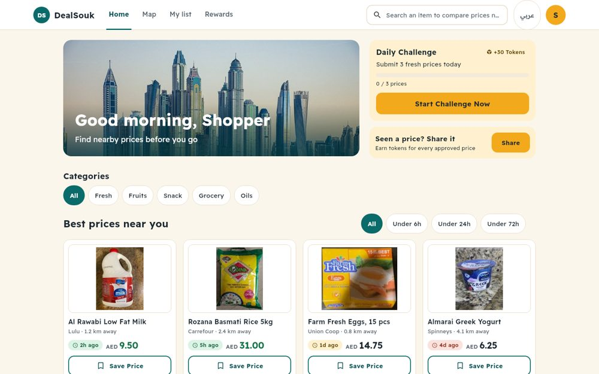 |
| 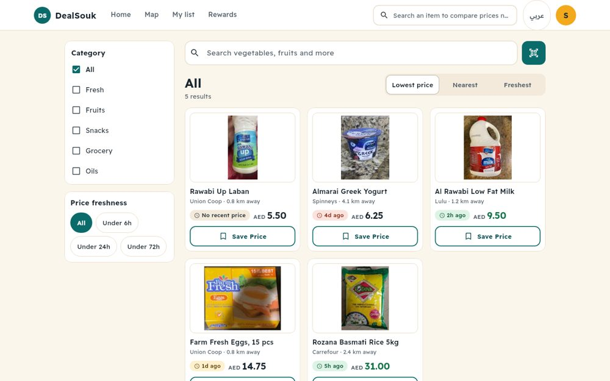 | 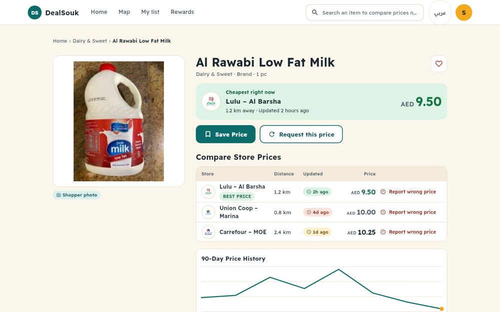 |
| 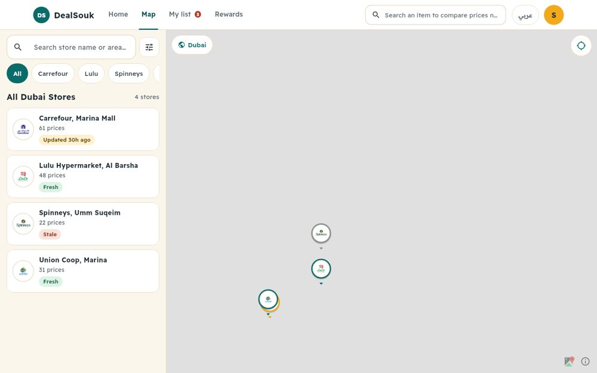 |  |
| 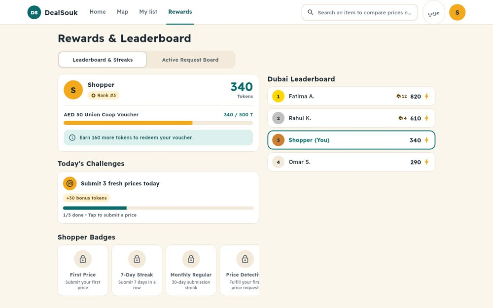 | 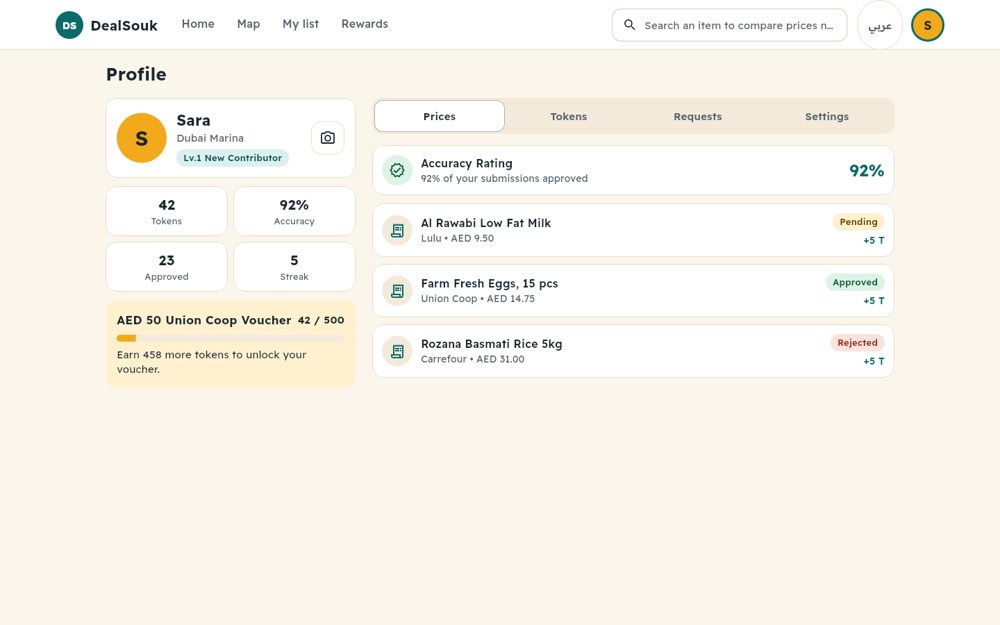 |
| 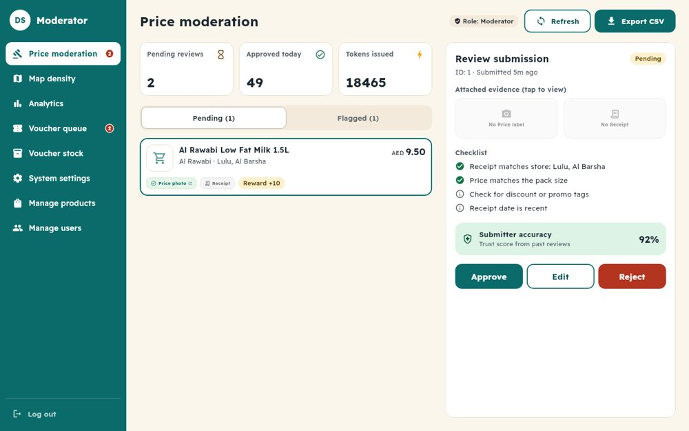 | 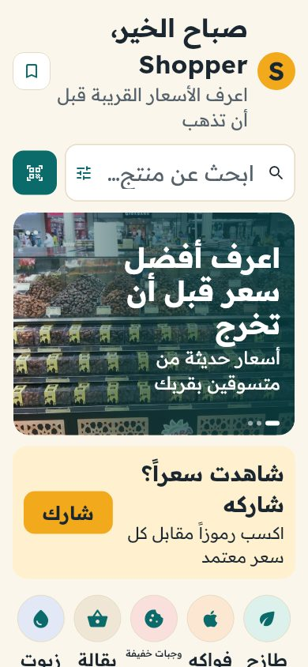 |

Phone: 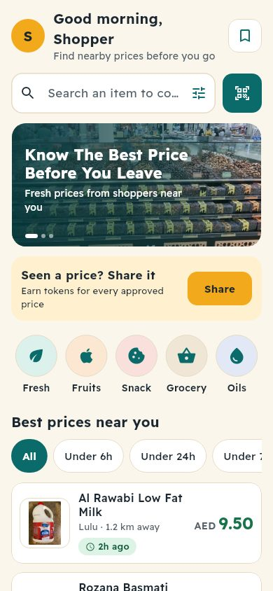 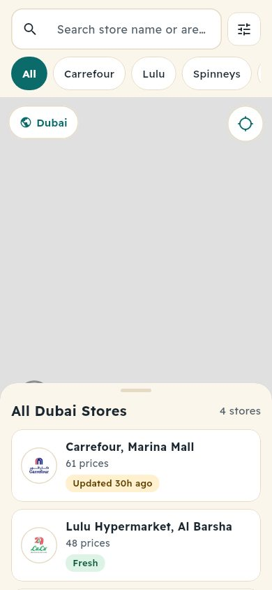 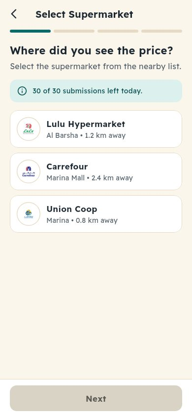 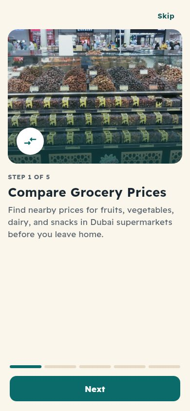 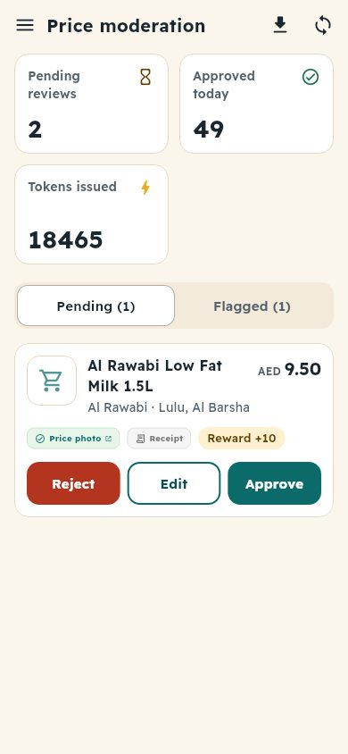

## How it was verified
- `flutter analyze`: no issues. `flutter test`: 100+ tests pass, including screenshot tests (`test/screenshots/`) that render every screen at phone, tablet and desktop, and in Arabic at 160% text. Overflows fail the tests.
- CI runs format, analyze, tests and the backend suite on every PR.

## Known gaps
- Moderator **dialogs** (edit submission, product/user forms, delete confirmations, voucher review) still use the older style and English text.
- Desktop map has no selected-store popup card (tapping a store opens the price sheet).
- Settings has no Notifications toggle, Help or Delete-account rows from the mockup, because no logic backs them yet.
- A few strings remain English-only: contributor level title, photo credits, some hint text on home/search. New home/search strings live in `discover_strings.dart` and should move into the ARB files.
- Submit steps 2 to 4 and the ask-a-price sheet were restyled and pass layout tests, but were not individually reviewed visually.
- Map tiles need `MAPBOX_ACCESS_TOKEN` (set it in Vercel and for builds).
- Photo credit for the Burj Khalifa and dunes images is a generic "Wikimedia Commons, free licences"; the individual authors should be added.
