# Using the app

A walk through the screens. The pictures are from [demo mode](Demo%20mode.md).

## Shoppers

### Sign in or look around

<a href="images/welcome.jpg">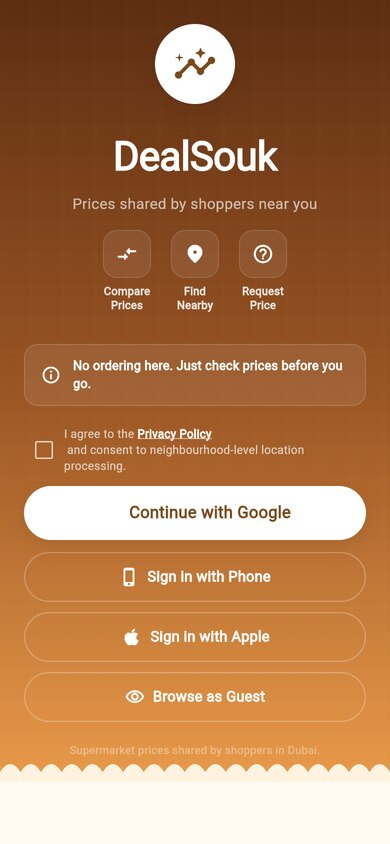</a>

Tick the privacy box and sign in with **Google**, a **phone code** or **Apple**, or press **Browse as Guest** to look around. The first time, you pick a home area (such as Dubai Marina) and see a short tour of the app.

### Find a price

1. On **Home**, type in the search box or tap a category.
2. Tap a product. You see the best price, the store, and a list of every store sorted from cheapest, with how far it is and how old the price is.
3. If a price looks wrong, tap **Report wrong price**.
4. Tap **Save Price** to add the product to your shopping list.

<a href="images/search.jpg">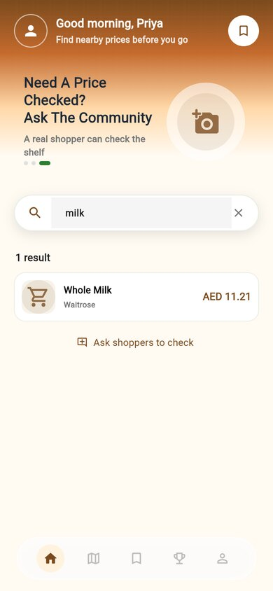</a>
<a href="images/product.jpg">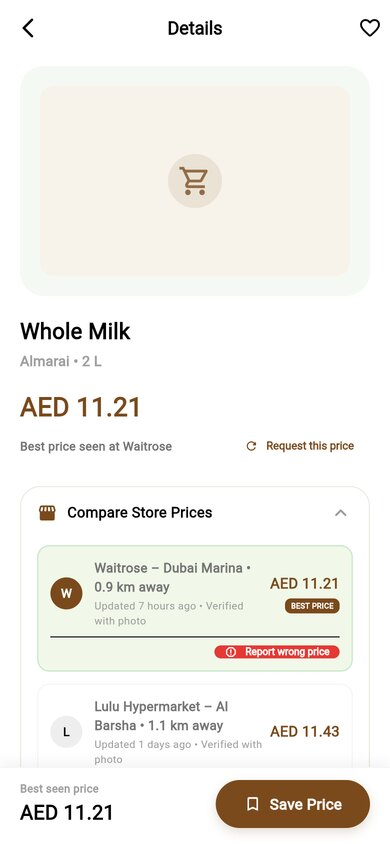</a>
<a href="images/product-prices.jpg">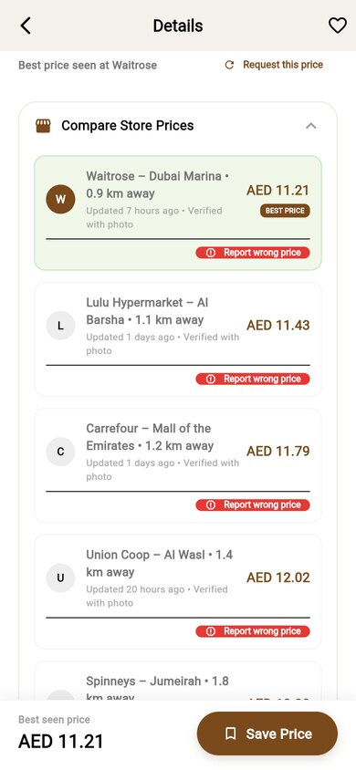</a>

If nobody has shared a price yet, tap **Ask shoppers to check** (or **Request this price**) and put a few tokens on it.

### Plan the trip

The **shopping list** (the third tab) works out the **cheapest basket**, the **closest option** and how much you would save, and tells you plainly that DealSouk does not sell groceries. The **map** (the second tab) shows the 18 Dubai stores. Filter by chain, search by name or area, and open a store to see its prices.

<a href="images/cart.jpg">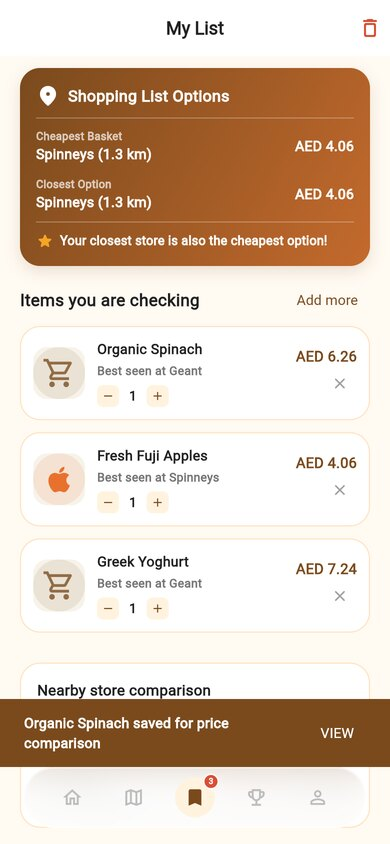</a>
<a href="images/map.jpg">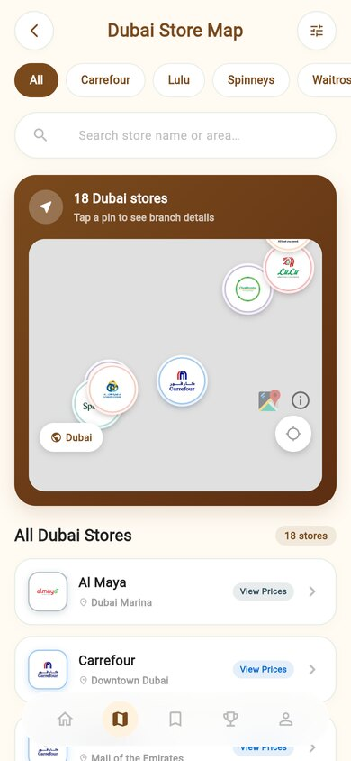</a>
<a href="images/store.jpg">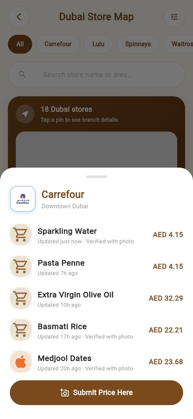</a>

### Share a price and earn

In a store, press **Submit Price Here**. The first step asks *Where did you see the price?* and lists the nearby supermarkets with how far each is, and it tells you how many submissions you have left today (30 a day by default). The next steps ask for the product, the price and a photo of the shelf tag or the receipt. A moderator checks it. When it is approved you earn tokens, which show in your history with the reason.

<a href="images/submit.jpg">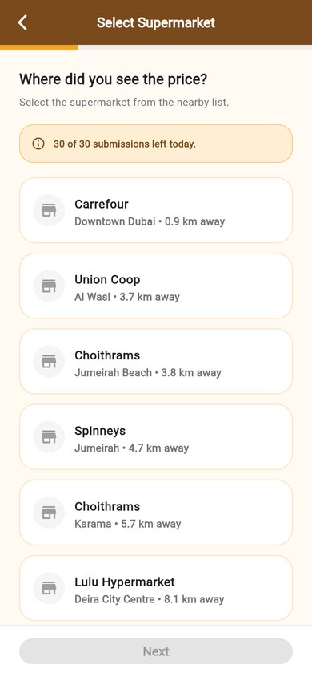</a>

### Rewards

The fourth tab (the cup) has two pages.

* **Leaderboard and Streaks:** your token balance, your rank, your streak, a progress bar to the next voucher (press **Claim Voucher Now** when you have enough), your badges, today's challenge, and the Dubai leaderboard for the month.
* **Active Request Board:** the price checks other shoppers need, each with a bounty. Share the price to take it.

<a href="images/rewards.jpg">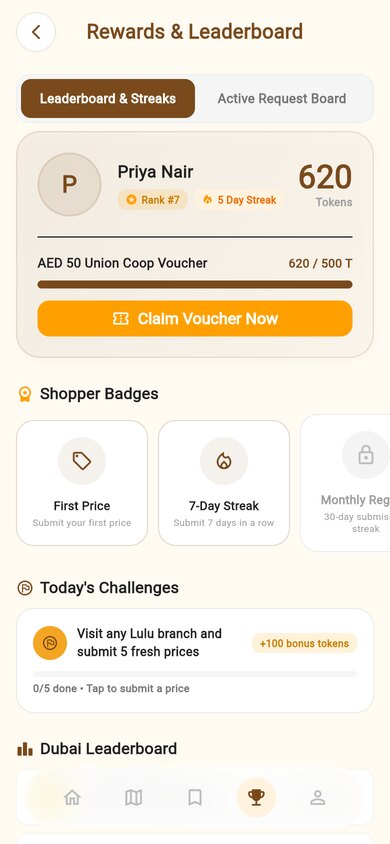</a>
<a href="images/leaderboard.jpg">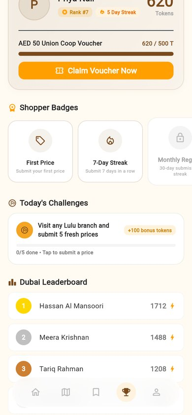</a>
<a href="images/requests.jpg">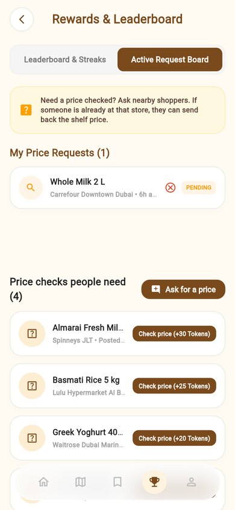</a>

### Profile

The last tab shows your tokens, accuracy, approved prices and streak. Open **My Submissions**, **Token History** and **My Requests**, change your name or photo, your home area and the language (English or Arabic), and re-run the tour.

<a href="images/profile.jpg">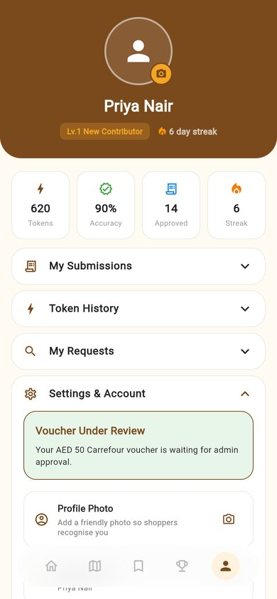</a>
<a href="images/tokens.jpg">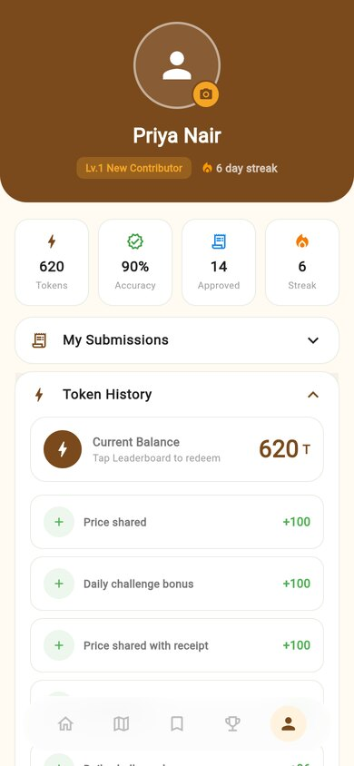</a>
<a href="images/submissions.jpg">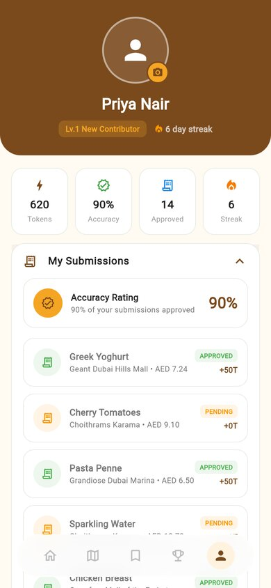</a>

## Moderators

Open the portal and sign in with a moderator account. The sidebar leads to every area.

| Section | What it does |
|---|---|
| **Price Moderation** | The queue of prices waiting for review, with counts for pending, approved today and tokens issued. Select one to audit it: look at the photos, follow the checklist, check the shopper's accuracy, then **Approve**, **Reject**, **Edit Submission**, or use **Warn**, **Suspend** or **Ban** on the shopper |
| **Map Density** | A map and a list of stores with the number of prices each has |
| **Analytics** | Prices today and this month, pending vouchers, trending products and coverage hotspots |
| **Voucher Queue** | Voucher requests with the shopper, their balance and the cost. **Approve** gives the shopper a code from stock and takes the tokens, **Reject** closes the request with an optional note |
| **Voucher Stock** | How many codes are left for each supermarket, and **Import Voucher Codes** |
| **System Settings** | The token earn rate, the voucher threshold, the daily limit and the cost of a request |
| **Manage Products** | Add, edit and remove products |
| **Manage Users** | Find users, change their tokens, and add or remove accounts |

<a href="images/admin-moderation.jpg">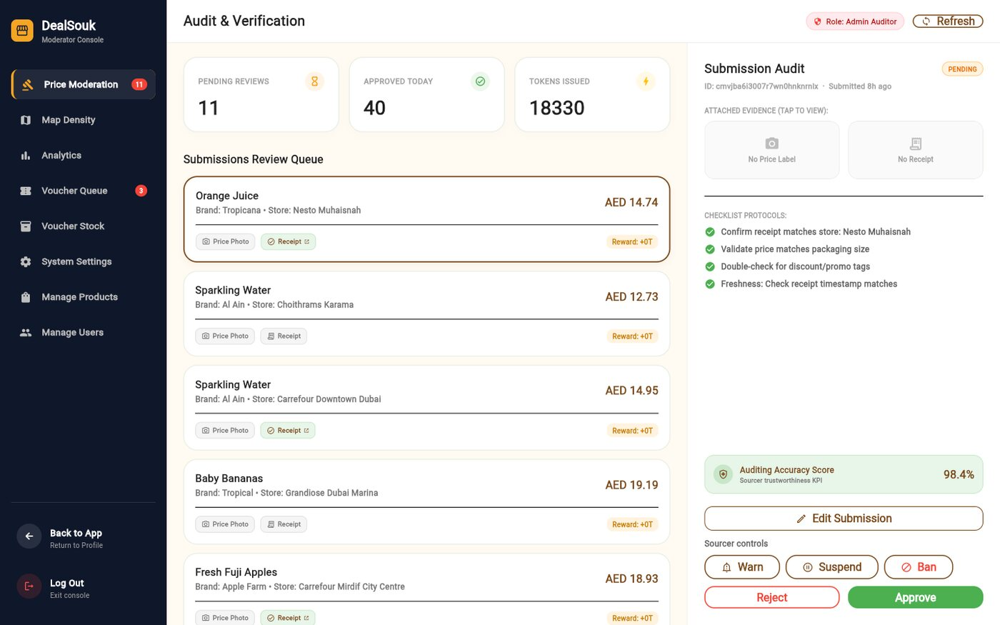</a>

Every warning, suspension and ban is written to an audit log. A shopper who has three prices rejected in 30 days is suspended for 7 days by itself.
